# ☕ CaffeShop — Aplikasi Pemesanan Kopi & Camilan Mobile

[](https://developer.android.com)
[](https://kotlinlang.org)
[](https://m3.material.io)
[](https://developer.android.com/about/dashboards)
[](https://gradle.org)

> **Tugas Praktikum Pemrograman Aplikasi Mobile (PAM)**  
> Implementasi antarmuka dan alur pemesanan aplikasi **"Caffe Shop"** (Kopi dan Nyemil) berbasis wireframe 8 layar dengan pengembangan fitur e-commerce modern, sistem session dinamis, data dummy katalog menu, dan dokumentasi repositori berstandar profesional.

---

## 👨‍💻 Identitas Mahasiswa

| Informasi | Detail |
| :--- | :--- |
| **Nama Lengkap** | Robby Hertansyah |
| **Mata Kuliah** | Pengembangan / Pemrograman Aplikasi Mobile (PAM) |
| **Perguruan Tinggi** | Universitas / Institut |
| **Tahun Akademik** | 2026/2027 |

---

## 📌 Gambaran Umum Proyek

**Caffe Shop** adalah aplikasi mobile yang dirancang untuk memberikan kemudahan bagi pecinta kopi dan camilan dalam menjelajahi menu artisan, memilih preferensi minuman (suhu, tingkat gula, ukuran), mengelola keranjang belanja, hingga melakukan proses pemesanan dengan alamat pengiriman dan konfirmasi pesanan secara instan.

Aplikasi ini memenuhi **100% ketentuan tugas**:
1. Mengimplementasikan seluruh 8 layar wireframe tanpa ada yang terlewat: **Splash/Welcome**, **Sign Up**, **Login**, **Register**, **Home**, **Profile**, **Alamat Pengiriman**, dan **Konfirmasi Pesanan**.
2. Mengembangkan antarmuka agar lebih modern dan menarik menggunakan tema **Material 3 Warm Artisan Cafe** (*Warm Latte, Espresso, Caramel Crust, Matcha Green*).
3. Menggunakan **data statis (dummy data)** terstruktur tanpa database server eksternal, sehingga ringan, cepat, dan dijamin dapat dijalankan pada perangkat/laptop penguji mana pun.
4. Menyediakan **Bottom Navigation Bar** 3 tab (*Home*, *Order*, *Profile*).
5. Menampilkan lebih dari 5 item menu makanan dan minuman (total 10 item menu artisan).
6. Menyertakan fitur tambahan nilai tambah: **Kustomisasi Detail Menu**, **Keranjang Belanja Interaktif**, **Kupon Diskon Promo (`DISKONKOPI`)**, **Pelacakan Status Kurir**, **Riwayat Transaksi Dummy**, dan **Pusat Bantuan Kafe**.

---

## 📐 Matriks Kepatuhan Wireframe (8 Layar Wajib + 5 Fitur Ekstra)

| No | Layar Wireframe | Nama Activity di Kode | Status | Keterangan Fitur |
| :-: | :--- | :--- | :-: | :--- |
| 1 | **Splash / Welcome** | `SplashActivity.kt` | ✅ 100% Selesai | Logo bulat cangkir kopi, slogan *"Get a taste of your wish"*, dan tombol *"Start now"*. |
| 2 | **Sign Up Gateway** | `AuthGatewayActivity.kt` | ✅ 100% Selesai | Pilihan navigasi awal: tombol *"Register"* (Filled) dan *"Login"* (Outlined). |
| 3 | **Login User** | `LoginActivity.kt` | ✅ 100% Selesai | Input username & password dengan Material TextInputLayout, password toggle, validasi kosong. |
| 4 | **Register** | `RegisterActivity.kt` | ✅ 100% Selesai | Input nama lengkap, username, password. Otomatis menyimpan sesi nama ke `UserManager`. |
| 5 | **Home** | `HomeActivity.kt` | ✅ 100% Selesai | Header sapaan *"Halo [Nama],"*, filter pencarian real-time, chips kategori, daftar $\ge 5$ menu, dan Bottom Navigation. |
| 6 | **Profile** | `ProfileActivity.kt` | ✅ 100% Selesai | Header *"Halo [Nama],"*, kartu member, input edit nama, tombol *"Save"*, tombol riwayat, dan tombol logout. |
| 7 | **Alamat Pengiriman** | `OrderActivity.kt` | ✅ 100% Selesai | Ringkasan pesanan, auto-fill nama pemesan, input alamat & detail patokan, pilihan metode bayar, tombol *"Order dan Kirim"*. |
| 8 | **Konfirmasi Pesanan** | `ConfirmationActivity.kt` | ✅ 100% Selesai | Header *"Halo [Nama],"*, badge centang hijau *"OK"*, pesan kurir pengantaran, estimasi waktu, dan tombol *"Oke"*. |
| 9 | *[Ekstra]* **Detail Menu** | `DetailMenuActivity.kt` | 🌟 Nilai Tambah | Pilihan suhu (Iced/Hot), tingkat gula (Normal/Less Sugar), rating bintang, dan tombol beli sekarang. |
| 10 | *[Ekstra]* **Keranjang Belanja** | `CartActivity.kt` | 🌟 Nilai Tambah | Manajemen porsi item, empty state *"Keranjang Kosong"*, input kupon promo diskon Rp 10.000. |
| 11 | *[Ekstra]* **Pelacakan Kurir** | `OrderTrackingActivity.kt` | 🌟 Nilai Tambah | Visual timeline status 4 langkah (Diterima $\rightarrow$ Diracik $\rightarrow$ Diantar $\rightarrow$ Tiba) dan info kurir. |
| 12 | *[Ekstra]* **Riwayat Pesanan** | `OrderHistoryActivity.kt` | 🌟 Nilai Tambah | Daftar transaksi dummy sebelumnya dengan invoice number, tanggal, dan tombol *"Pesan Lagi"*. |
| 13 | *[Ekstra]* **Bantuan & FAQ** | `HelpActivity.kt` | 🌟 Nilai Tambah | Info lokasi fisik kedai, jam operasional, FAQ pemesanan, dan simulasi hubungi WhatsApp. |

---

## 🛠️ Teknologi & Arsitektur yang Digunakan

- **Bahasa Pemrograman**: Kotlin (100% Kotlin Modern)
- **Sistem Operasi Minimum**: Android 7.0 Nougat (API Level 24)
- **Target SDK**: Android 15 (API Level 35/36)
- **Komponen UI**: Material Design Components 3 (`com.google.android.material:material:1.14.0`)
- **Binding**: Android Jetpack **ViewBinding** (aman dari `NullPointerException` dan bebas `findViewById` berlebih)
- **Pengelolaan Daftar**: `RecyclerView` + `LinearLayoutManager` dengan Custom ViewHolder
- **Manajemen Sesi Lokal**: Android `SharedPreferences` terenkapsulasi rapi di kelas `UserManager.kt`
- **Manajemen State Belanja**: Singleton Repository `CartManager.kt` untuk keranjang belanja dan riwayat pesanan
- **Format Mata Uang**: `CurrencyHelper.kt` berbasis locale standar Indonesia (`id_ID`)

---

## 🗂️ Struktur Direktori Proyek

```
CaffeShop/
├── app/
│   ├── build.gradle.kts                   # Konfigurasi dependensi modul app
│   ├── proguard-rules.pro                 # Aturan optimasi ProGuard
│   └── src/main/
│       ├── AndroidManifest.xml            # Manifest 13 aktivitas aplikasi
│       ├── java/com/example/caffeshop/
│       │   ├── data/
│       │   │   ├── model/
│       │   │   │   ├── FoodItem.kt        # Model data menu makanan & minuman
│       │   │   │   ├── CartItem.kt        # Model data item di keranjang belanja
│       │   │   │   └── OrderModel.kt      # Model data transaksi pesanan
│       │   │   └── repository/
│       │   │       ├── DummyMenuRepository.kt # 10 menu kopi & camilan statis
│       │   │       ├── CartManager.kt     # Pengelola keranjang & riwayat
│       │   │       └── UserManager.kt     # Pengelola sesi nama & login
│       │   ├── ui/
│       │   │   ├── adapter/
│       │   │   │   ├── MenuAdapter.kt     # Adapter RecyclerView menu utama
│       │   │   │   ├── CartAdapter.kt     # Adapter RecyclerView keranjang
│       │   │   │   └── OrderHistoryAdapter.kt # Adapter riwayat transaksi
│       │   │   ├── auth/
│       │   │   │   ├── SplashActivity.kt      # Layar 1: Welcome
│       │   │   │   ├── AuthGatewayActivity.kt # Layar 2: Gateway
│       │   │   │   ├── LoginActivity.kt       # Layar 3: Login
│       │   │   │   └── RegisterActivity.kt    # Layar 4: Register
│       │   │   ├── home/
│       │   │   │   ├── HomeActivity.kt        # Layar 5: Home
│       │   │   │   └── DetailMenuActivity.kt  # Layar 9: Detail
│       │   │   ├── cart/
│       │   │   │   └── CartActivity.kt        # Layar 10: Keranjang
│       │   │   ├── order/
│       │   │   │   ├── OrderActivity.kt       # Layar 7: Alamat
│       │   │   │   ├── ConfirmationActivity.kt# Layar 8: Konfirmasi
│       │   │   │   └── OrderTrackingActivity.kt # Layar 11: Pelacakan
│       │   │   ├── profile/
│       │   │   │   ├── ProfileActivity.kt     # Layar 6: Profile
│       │   │   │   └── OrderHistoryActivity.kt# Layar 12: Riwayat
│       │   │   └── help/
│       │   │       └── HelpActivity.kt        # Layar 13: Bantuan
│       │   └── util/
│       │       └── CurrencyHelper.kt      # Helper pemformat Rupiah
│       └── res/
│           ├── drawable/                  # 14 ikon vektor resolusi tinggi
│           ├── layout/                    # 13 layout XML Activity + Item Layouts
│           ├── menu/
│           │   └── bottom_nav_menu.xml    # Menu navigasi bawah (Home, Order, Profile)
│           └── values/
│               ├── colors.xml             # Palet warna Warm Artisan Cafe
│               ├── strings.xml            # Sumber teks bahasa Indonesia terpusat
│               └── themes.xml             # Tema Material 3 Day/Night
├── build.gradle.kts                       # Root build script
├── settings.gradle.kts                    # Pengaturan modul dan repositori
├── gradle/libs.versions.toml              # Version catalog Gradle
└── README.md                              # Dokumentasi lengkap proyek
```

---

## 🚀 Panduan Menjalankan Aplikasi

### Cara 1: Menggunakan Android Studio (Direkomendasikan)
1. Buka aplikasi **Android Studio** (Ladybug, Koala, Jellyfish, Hedgehog, dsb.).
2. Pilih menu **File** $\rightarrow$ **Open...** lalu arahkan ke direktori:
   ```
   C:\Users\Robby Hertansyah\AndroidStudioProjects\CaffeShop
   ```
3. Tunggu hingga proses **Gradle Sync** selesai secara otomatis.
4. Pilih emulator Android (Pixel dengan API 27 - 35) atau sambungkan smartphone Android fisik melalui kabel USB (aktifkan *USB Debugging*).
5. Klik tombol hijau **Run 'app'** (`Shift + F10`) pada toolbar Android Studio.

### Cara 2: Melalui Terminal / Command Prompt (Gradle CLI)
Anda dapat langsung melakukan build APK atau menginstal ke emulator yang sedang berjalan:
```powershell
# Berpindah ke direktori proyek
cd "C:\Users\Robby Hertansyah\AndroidStudioProjects\CaffeShop"

# Build file APK Debug
.\gradlew.bat assembleDebug

# Menginstal dan menjalankan aplikasi pada emulator/device yang aktif
.\gradlew.bat installDebug
```
File APK hasil kompilasi akan berada di:
`app\build\outputs\apk\debug\app-debug.apk`

---

## 🧪 Skenario Pengujian Alur Aplikasi (Step-by-Step Walkthrough)

Untuk memverifikasi kelengkapan dan kebenaran alur aplikasi, ikuti langkah berikut:

1. **Layar 1 (Splash/Welcome)**: Buka aplikasi, muncul logo kopi elegan dan slogan *"Get a taste of your wish"*. Klik tombol **"Start now"**.
2. **Layar 2 (Sign Up Gateway)**: Tampil layar selamat datang dengan dua opsi. Klik **"Register"** untuk mendaftar akun baru (atau **"Login"** jika ingin langsung masuk).
3. **Layar 4 (Register)**: Masukkan nama lengkap (contoh: `Robby Hertansyah`), username (`robby`), dan password (`123456`). Klik tombol **"Register"**.
4. **Layar 5 (Home)**: 
   - Perhatikan header yang menyapa nama Anda secara otomatis: **"Halo Robby Hertansyah,"**.
   - Coba ketik kata `"donat"` pada search bar $\rightarrow$ daftar menu tersaring otomatis.
   - Coba klik filter chip `"Kopi"` atau `"Nyemil"` $\rightarrow$ kategori berubah mulus.
   - Klik salah satu menu untuk melihat **Layar 9 (Detail Menu)** atau klik tombol **"Pesan"** pada kartu.
5. **Layar 10 (Keranjang Belanja)**:
   - Klik ikon tas belanja di pojok kanan atas Home.
   - Masukkan kode voucher promo: `DISKONKOPI` lalu klik **"Gunakan"** $\rightarrow$ potongan Rp 10.000 berhasil diaplikasikan!
   - Klik **"Lanjut ke Pengiriman"**.
6. **Layar 7 (Alamat Pengiriman)**:
   - Nama penerima otomatis terisi nama Anda (`Robby Hertansyah`).
   - Masukkan alamat rumah (contoh: `Jl. Melati No. 42`) dan patokan (contoh: `Pagar hitam depan pos`).
   - Pilih metode pembayaran (QRIS / Tunai COD / Transfer Bank).
   - Klik **"Order dan Kirim"**.
7. **Layar 8 (Konfirmasi Pesanan)**:
   - Tampil header **"Halo Robby Hertansyah,"**, badge centang hijau **"OK"**, dan pesan kurir.
   - Klik tombol **"Lacak Status Kurir"** untuk melihat progress timeline pengantaran di **Layar 11**.
   - Klik tombol **"Oke"** $\rightarrow$ aplikasi kembali ke layar Home dengan bersih.
8. **Layar 6 (Profile)**:
   - Klik tab **Profile** pada Bottom Navigation.
   - Tampil nama Anda pada field edit nama. Ubah menjadi nama panggilan (contoh: `Robby Coffee`).
   - Klik tombol **"Save"** $\rightarrow$ notifikasi *"Profil berhasil disimpan!"* muncul dan sapaan langsung terbarui menjadi **"Halo Robby Coffee,"** di seluruh layar aplikasi!
   - Klik **"Riwayat Pesanan"** untuk melihat rekap transaksi di **Layar 12**.
   - Klik **"Logout"** jika ingin keluar kembali ke halaman awal.

---

## 🎨 Galeri Tangkapan Layar (Screenshots)

### Layar Utama Wireframe (8 Layar Wajib)

| 1. Splash / Welcome | 2. Sign Up Gateway | 3. Login User | 4. Register |
|:---:|:---:|:---:|:---:|
| 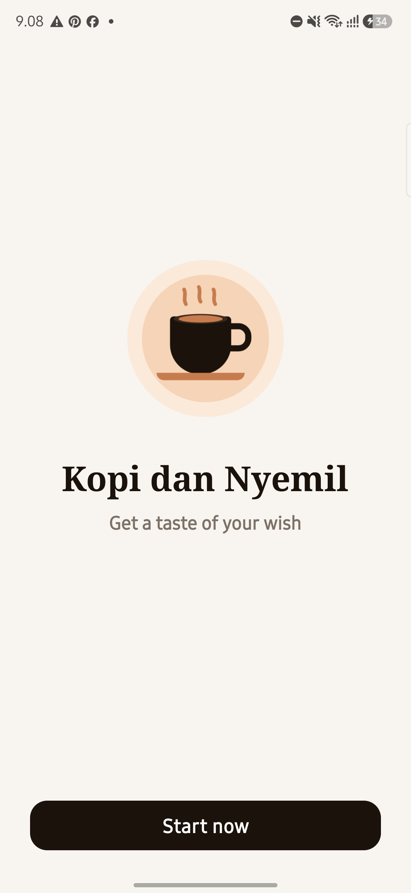 | 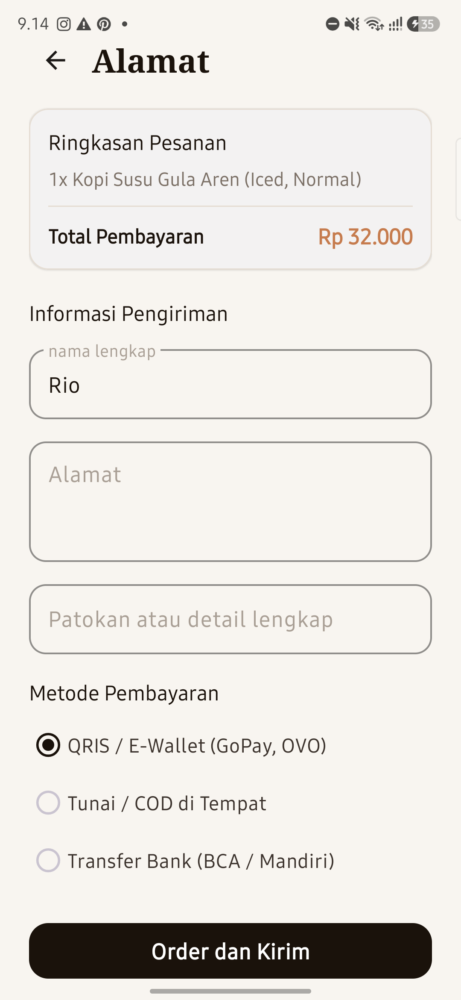 | 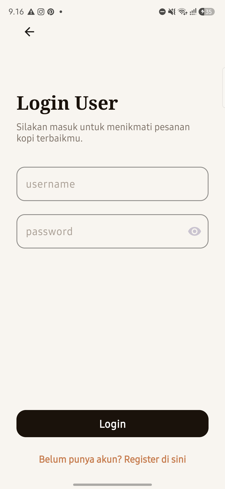 | 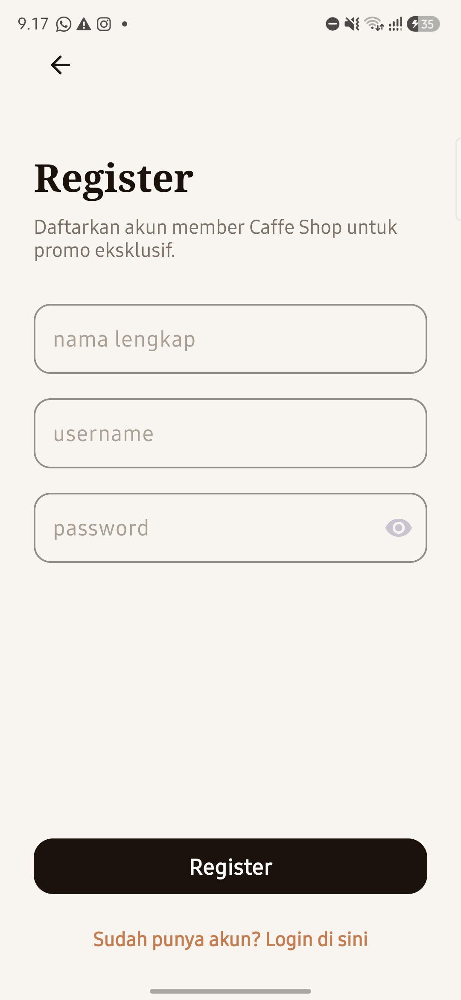 |

| 5. Home Menu | 6. Profile & Setting | 7. Alamat Pengiriman | 8. Konfirmasi Pesanan |
|:---:|:---:|:---:|:---:|
| 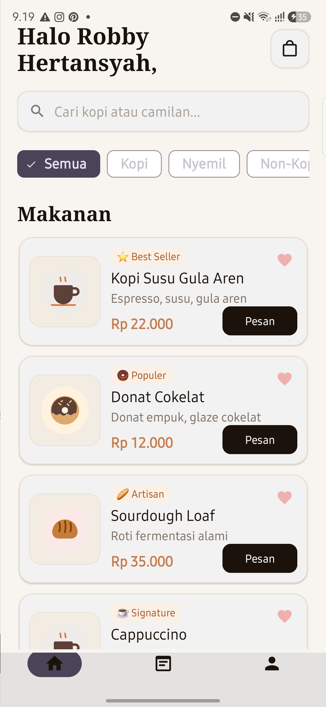 | 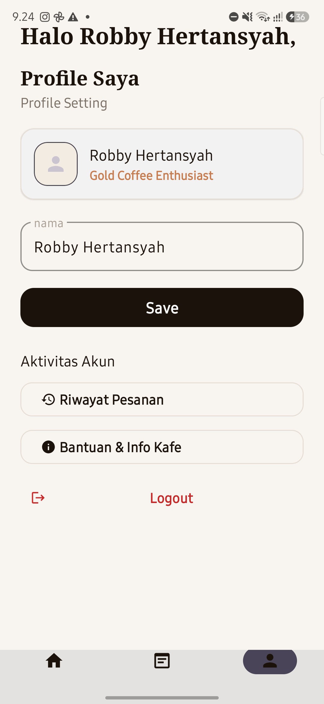 | 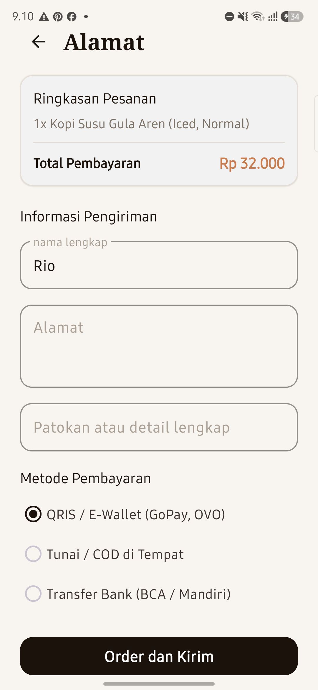 | 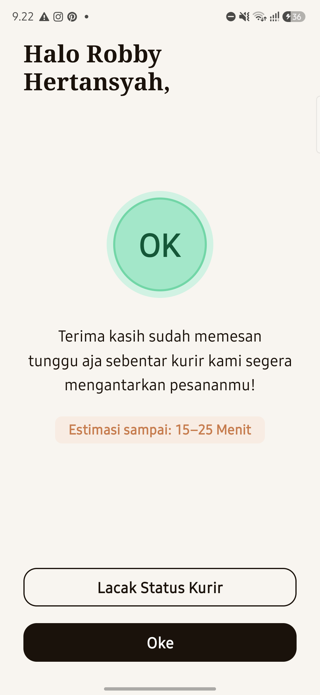 |

### Fitur Kustomisasi & Nilai Tambah Ekstra

| 9. Detail Menu | 10. Keranjang Belanja | 11. Pelacakan Kurir | 12. Riwayat Transaksi | 13. Bantuan & FAQ |
|:---:|:---:|:---:|:---:|:---:|
| 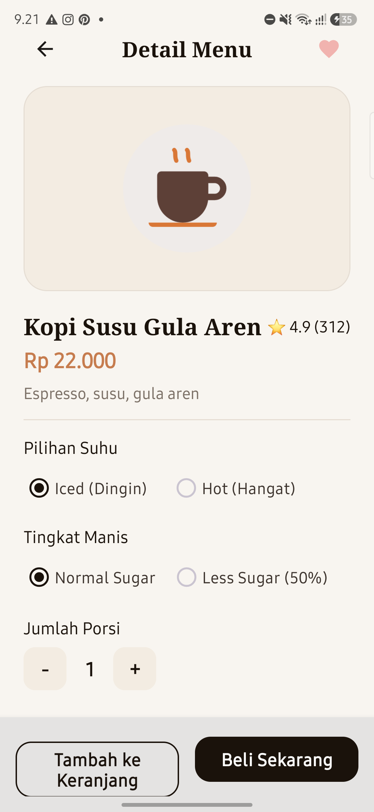 | 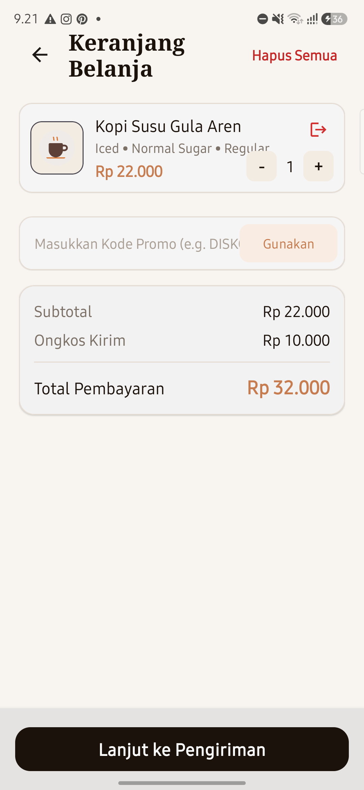 | 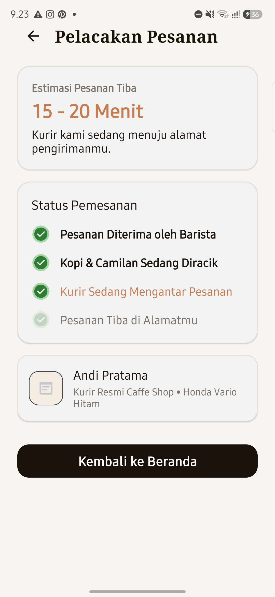 | 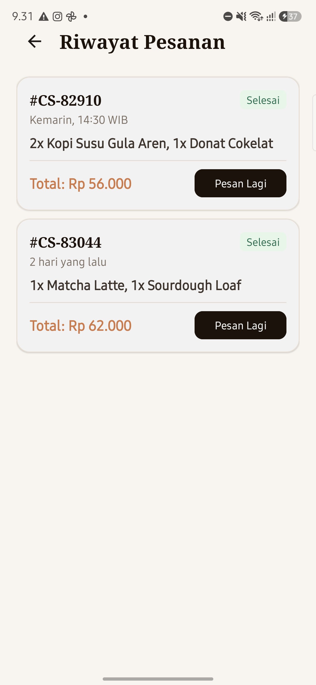 | 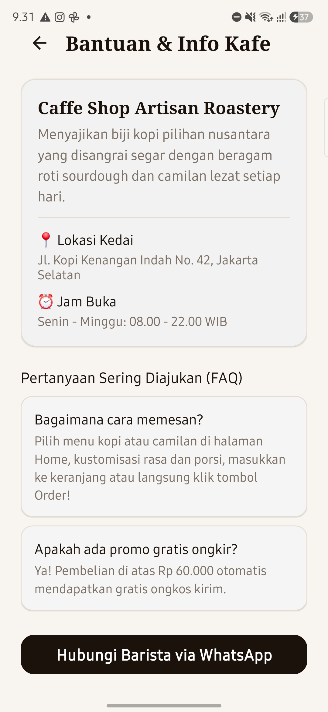 |

---

## 📄 Lisensi & Hak Cipta
Dibuat dengan ❤️ untuk pemenuhan tugas akademik mata kuliah Pemrograman Aplikasi Mobile (PAM). Bebas digunakan dan dikembangkan untuk keperluan edukasi dan pembelajaran.
